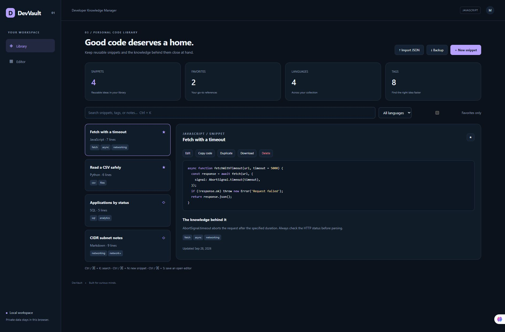

# DevVault — Developer Snippet & Knowledge Manager

کتابخانهٔ کد و یادداشت با جست‌وجو، برچسب، علاقه‌مندی، نمایش رنگی کد و پشتیبان‌گیری JSON.

A working portfolio project exploring developer snippet & knowledge manager, built with JavaScript, HTML, CSS, and browser APIs.



## Features

- Create, edit, duplicate, favorite, tag, search, and delete code snippets and notes.
- Language-aware syntax highlighting, keyboard shortcuts, local persistence, and copy/download actions.
- Validated JSON backup import/export with duplicate-ID protection.

## Run locally

Use **Node.js 22.13+**. Clone the repository, then run:

```sh
git clone https://github.com/MahtaRahmati/devvault.git
cd devvault
npm start
```

Open **http://127.0.0.1:4100**. The bundled sample provides a starting point; your own data can be entered or imported.

```sh
npm test
```

PORT can be changed through the environment. No dependency installation or build step is required.

## Project structure

- `public/` — responsive interface and browser-side domain logic
- `tests/` — meaningful domain checks
- `server.mjs` — small local static server
- `docs/` — screenshot and bilingual LinkedIn introduction

## Deployment

Serve the public/ folder through any static host. A GitHub Pages workflow is included. Enable **Settings → Pages → Source: GitHub Actions** to publish it. Expected URL after successful deployment: https://MahtaRahmati.github.io/devvault/ .

## Scope & data handling

Device-local library in localStorage; no login or cloud sync. Syntax coloring is a lightweight lexical highlighter, not a compiler. Imported code is displayed as text and never executed. Export backups before clearing browser data.

All sample records and addresses are fictional. The interface works on desktop and mobile and includes keyboard focus states, labeled controls, and status/error feedback.

## Built with

Native ES modules, DOM APIs, and CSS. No framework or chart dependency.

## License

MIT.
